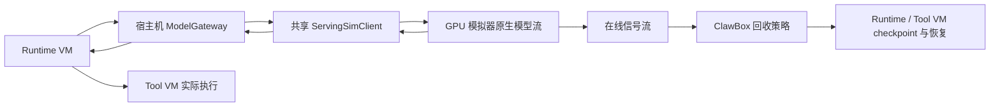

# GPU 模拟器与 CPU ClawBox 协同实验：问题归因与修复计划

日期：2026-11-14。目标：在 kunpeng 上完成可审计的 Full1280 GPU CPU 协同实验，并判断 GPU 在线信号驱动的 VM 回收是否实际生效。

本文是待执行的工程计划，不是修复完成或实验成功报告。本次仅核查代码、读取已有实验记录并编写计划，未部署代码、启动新实验、停止服务或改动 GPU 模拟器。`think_end` 按已确定方案处理，本计划不要求补 reasoning 数据或证明预启动收益。

## 1. 结论与完成目标

基础协同已经在单会话真实 VM 实验中跑通；Full1280 尚未跑通。现有证据不支持“需要重做接入架构”，也不支持“增加模拟 GPU 数量或延长超时即可解决”。当前需要解决四件事：

1. **定位并修复 GPU 请求读取失败。** 已知异常类型为 `ReadError`，会导致 Runtime 模型调用失败；底层断连原因仍未知。
2. **解释并控制模拟时钟与实际执行的偏差。** 已观测到秒级、数十秒级晚到；尚未分离模拟器推进、服务发送和 CPU 消费各自的贡献。
3. **修复失败路径的 GPU 收尾。** 现有收尾脚本在 CPU 失败时先断言退出，无法继续关闭 GPU、生成最终报告。这是代码已确认的缺陷。
4. **完成全量对账与策略有效性检查。** 922 个未完成会话的等待位置、模型请求与 Tool 执行的对应关系、实际回收和恢复路径，都需要形成最终证据。

区分两层通过标准：

| 层次 | 通过意味着什么 | 不能据此宣称什么 |
| --- | --- | --- |
| 功能闭环 | 全部目标会话完成，模型请求没有重复执行，Tool 与 VM 生命周期正确，两侧收尾完成 | 不能自动证明模拟器跟得上实时执行，不能自动证明调度收益 |
| 实验有效 | 功能闭环通过，时序误差符合事先冻结的有效性要求，实际触发的回收/恢复与配置一致 | 没有对照实验时，不能声称 GPU 感知策略提高了吞吐或降低了延迟 |

若全量运行完成但模拟器持续落后，只能报告“功能完成，性能结论受限”；若没有实际 GPU 感知回收，只能报告“协同完成，策略未获得有效覆盖”。不得把二者包装成论文机制的成功验证。

## 2. 已有证据及其边界

### 2.1 单会话验证

本地回执 `.artifacts/serving-sim-traceless-20261113/c1-verified-29.json` 记录：

- 真实 VM 实验成功且清理完成。
- 25 次模型调用，每次恰好执行一次；52 个 Tool 步骤。
- 该回执仅覆盖单会话正确性和小规模开销，不是 Full1280 证明。

### 2.2 失败的 Full1280

旧 run ID：`gpu-traceless-full1280-20261114-01`。

| 事实 | 证据状态与解释 |
| --- | --- |
| run/arm 均为 `failed`，`cleanup_verified=true`，CPU 命令退出码 1 | 本次从 kunpeng 再次读取确认；清理字段只说明 CPU 工作流清理结果 |
| 配置的 arm 超时为 5400 秒；结束时 922 个 session futures 未完成 | 前次审计结果；超时是终止条件，不是底层根因 |
| 79 个完成、279 个失败、922 个未完成，总计 1280 | 前次审计统计；“完成”仍需结合最终 validation 判断是否满足实验要求 |
| 279 个失败中，270 个为 Runtime 模型上游 502，9 个为 gateway 会话未完成 | 前次审计分类；502 是向 Runtime 暴露的失败，不能据此推断 GPU HTTP 服务返回了 502 |
| gateway 共 24,653 条请求：23,711 条成功交付、270 条 `ReadError`、672 条 `session closed before response completed` | 前次审计统计；672 条多为会话结束或清理造成的次生取消，不能当作 672 次独立网络根因 |
| GPU access log 记录 24,382 个 POST，状态均为 200 | HTTP 200 只表示响应开始，不能证明 SSE 收到成功终止消息；数量差不能代替 request ID 对账 |
| 原冻结工作负载预计 54,434 次模型调用，1280 个会话、502 个 case | 下一次沿用相同工作负载时，以冻结输入清单再次核对该值；离线验收可以使用输入清单，CPU 在线调度不能读取未来 trace |
| `clawbox-persistence.json` 为 `mode=final, finalized=false` | 本次再次读取确认；GPU 最终报告没有完成保存 |
| `realized.json=[]`，`validity.json` 是启动时零步数、零 lag 样本的报告 | 前次审计结果；不能据此声称运行没有时序问题 |

本次再次成功读取了 `run-state.json`、CPU 退出回执、GPU persistence 标记及中途开销报告。另一次请求级全量审计在 SSH reset 后中断，没有形成完整新结果。因此，上表明确区分本次复核和前次审计数据，不把未完成的审计当作已验证。

### 2.3 时序问题已有实测证据

本次再次读取 `live-overhead-51.json`，其范围为**运行中途的部分样本**：

| 指标 | 样本数 | p50 | p95 | p99 |
| --- | ---: | ---: | ---: | ---: |
| 信号相对预定墙钟时刻的晚到 | 31,491 | 4.297 s | 28.271 s | 32.759 s |
| CPU 收到信号到策略 callback 事件 | 31,406 | 0.051 ms | 3.758 ms | 18.431 ms |
| CPU 收到模型完成到响应 callback 事件 | 5,336 | 8.004 ms | 237.200 ms | 678.690 ms |

第一行历史字段名是 `gpu_signal_transport_age_ms`，但不能解释为纯网络耗时。GPU 的 `wall_t` 是虚拟事件时刻按时钟映射得到的预定墙钟时间，并不是实际发送时间。该指标同时包含模拟推进落后、服务端处理/发送延迟、传输和客户端消费延迟。

第二行较小，说明这些样本里的 callback 本身不足以解释第一行的全部晚到；它也不能排除客户端在读取信号之前的事件循环拥塞。禁止将两个不同总体的分位数相减作为某一环节的耗时。

### 2.4 当前版本与 `think_end` 状态

- 本地 ClawBox HEAD 为 `441005e`（`think_end issue`）；前一个接入提交为 `ba96738`。之前的 `think_end` 修复已进入本地提交。本次未部署到 kunpeng。
- 上次核验的 GPU `sim-release` revision 为 `a97dfd402a1f47c5432a01fa3faec74e4046a48e`；远端源快照回执记录相同 revision。本文不声称本次重新确认了 GitHub 最新 HEAD，也不声称本次完成了远端全部源文件重哈希。
- 原生模拟器对缺失 reasoning count 的调用不发 `think_end`；ClawBox 仅接受在线信号中 `source=trace` 的边界，忽略来源缺失或其他来源的 `think_end`。CPU 不通过 trace 或首 token 猜测边界。
- 本次工作负载缺少 reasoning count，因此按完整模型响应触发 Runtime 恢复，按实际 Tool 请求恢复 Tool VM；零预启动是预期行为，不是本计划的失败条件。

## 3. 运行链路与问题发生位置



宿主机持有 GPU 模型流；Runtime checkpoint 后重连的是宿主机 gateway。不能因 Runtime 恢复而重新提交同一 GPU 推理。GPU 流断开会触发模拟器取消请求，原生接口也不提供可任意重试的相同 request ID 续传保证。

“GPU 8A”表示八张被模拟的 GPU；原实验模拟器实际消耗的是 kunpeng 上 CPU 240–243 的计算资源。模拟 GPU 容量决定建模出来的排队与完成时间，真实 CPU 预算决定模拟器能否及时计算和交付事件。这是两个不同问题。

## 4. 根因分析

### R1：模型请求失败——传播路径已明确，底层断连原因未明确

已知路径是：宿主机模型客户端读取失败 → gateway 记录 `ReadError` → Runtime 收到模型调用失败/上游 502 → 会话失败。前次统计中 270 个 `ReadError` 的请求持续时间为 0.0068–4.479 秒，中位数约 0.098 秒；这不符合“它们都是等待完整模型生成直到长超时”的解释。

当前 `clawbox/replay/model_gateway.py::_produce` 只持久化 `str(exc) or type(exc).__name__`。异常消息为空时，只剩一个 `ReadError` 名称，没有底层 cause、errno、发生阶段和最近收到的 SSE 位置。**因此诊断信息不足是已确认缺陷，连接失败的根因仍是待验证项。**

| 候选原因 | 现有证据是否足够 | 最小判定证据 | 确认后的修复方向 |
| --- | --- | --- | --- |
| GPU 进程 FD 上限不足 | 不够。只看见过新 SSH shell 的 1024，未取得故障进程的真实限制/峰值 | 故障进程 `/proc/<pid>/limits`、FD 数时间序列、`EMFILE/ENFILE` 与同一错误窗口 | ClawBox launcher 设置并校验 NOFILE，记录生效值；不要仅修改交互 shell |
| 服务退出、OOM、重启或主机异常 | 不够；故障进程已不在，历史 journal 可用性有限 | 退出码/信号、cgroup memory events、对应时间的服务和内核记录 | 只修实际触发的资源/生命周期问题；保留完整退出回执 |
| HTTP 连接复用或建连/读流阶段错误 | 不够；现有错误不区分收到响应头前后 | request ID 对应的提交、服务收到、响应头、首帧、终止帧、异常链 | 按复现结果修客户端或依赖/连接管理；不预先禁用全部 keepalive |
| 共享事件循环/同步工作阻塞 | 代码存在这种可能，但尚无与 ReadError 的直接因果证据 | 同窗口事件循环延迟、服务状态、请求阶段、必要时短时 profiling | 只移动已测量的阻塞工作；保留顺序与异常传播 |

CPU worker 已有 `ensure_worker_fd_limit(concurrency)`，所需下限为 `512 + 16 × concurrency`。Full1280 对应 20,992。不能把 GPU launcher 的限制缺口误说成 CPU worker 没处理 FD。CubeAPI 的 65,536 要求也应单独核验。

### R2：明显时序晚到——现象已确认，主耗时环节未知

已确认的机制：

1. `k=1` 只规定虚拟时间到墙钟的换算，不保证宿主机按时算完。
2. 原生 paced driver 在事件循环中串行推进事件，每次处理后让出执行权。
3. 请求提交路径包含同步 prompt 渲染/tokenization；这些工作可能影响服务端响应，但需采样确认占比。
4. ClawBox 的模型流、信号流共享一个客户端 asyncio loop；信号消费中直接写 observation 日志并同步调用策略 callback，后者会取得策略锁。
5. GPU 感知策略只允许使用有效的 queue/prefill 剩余时间估计。默认有效期 5 秒，默认回收门槛 1 秒；收到首 token 后估计清除。decode-only 等待不会自动授权回收。

因此，晚到既可能污染 GPU CPU 时序实验，也可能让估计在 CPU 收到时已过期，缩小可回收 VM 集合。但**不能直接推出“所有信号都过期”“策略从未回收”或“922 个未完成会话都被该问题卡死”**。中途报告实际上已有 pause、restore、relay reconnect 事件，必须逐请求关联其触发原因。

`queued.est_wait_s` 来源于在线 prompt 工作量和近期处理速率，包含自身尚未处理的 prompt；未知缓存命中等因素使其只是启发式估计，不是剩余时间的严格下界。队列位置不变时也不保证持续刷新。不能通过无限放大有效期、把估计当保证或悄悄退化为 wait 策略来“跑通”。

### R3：GPU 最终报告丢失——确定的失败收尾缺陷

`.artifacts/serving-sim-traceless-20261113/stop-full-gpu-55.py` 的顺序是：

1. 断言 CPU exit code 为 0。
2. 断言 run 成功且 CPU 清理完成。
3. 才向 GPU 发 SIGINT、等待退出并核查 persistence。

CPU 已失败，前置断言会阻止该脚本走到 GPU 收尾。与此同时，ClawBox `attach_persistence(..., mode='final')` 将中间原生 `save()` 延后到 lifespan 关闭；未走完关闭过程，就只留下启动报告。

这是**失败时不能可靠产出 GPU 最终证据的已确认原因**，不是 270 个 ReadError 的已证明起因。还不能仅凭现有文件确定 GPU 最后是被哪个进程、重启或信号终止的。

### R4：922 个会话未完成——不能只用超时或 GPU 容量解释

5400 秒超时表示工作流在预算内没有完成，尚未区分以下等待：GPU 请求仍在服务、VM 创建/恢复排队、内存 admission 等待、无符合条件的回收对象、Tool 运行、错误后的取消收敛。

需在末段固定时间窗口内统计每个会话的最后状态、是否还有语义进度、正在等待的资源，以及被等待者能否独立推进。只有出现无进度的循环等待或缺失唤醒证据，才称为死锁；只有模拟器及时推进且 GPU 建模队列持续积压，才能讨论模拟 GPU 容量。

若资源预算下 GPU 策略无法找到可回收对象，但状态机工作正常，应报告策略适用条件或容量不足。修复状态机错误与改变策略语义是两件事；后者需要单独的实验设计，不能藏在接入修复里。

### R5：Tool 语义与恢复路径——需要最终对账，尚无新根因结论

中途记录存在 `harmful_replay_tool_divergence` 等事件。事件名称或计数本身不能证明全部是实质偏离，也不能全部当作无害差异。应对照最终 validation，区分 trace 原本的工具失败、允许的显示差异、执行环境变化和实际漏执行/重复执行。

保留原工作流的 validation 规则；不得删掉失败事件、修改 recorded outputs 或把失败步骤算成功来满足完成标准。

## 5. 修复计划与依赖

执行顺序：**P0 证据冻结 → P1 诊断与 P2 收尾 → P3 定向修复/时序定位 → P4 闭环验证 → P5 Full1280 验收**。P1、P2 代码可以在同一个改动批次完成；不要求为了每个小改动单独部署或重跑。

### P0：固定输入与复用已有环境

- 保存旧 run 的输入、run-state、arm result、gateway 记录、事件和 GPU 输出目录；不覆盖、续写或重新使用旧 run ID。
- 为下一次执行记录 CPU commit、GPU revision/源文件哈希、Python 依赖、tokenizer/cost-model assets、topology digest、manifest digest、主机配置和命令。
- GPU 源码保持不变。相同 upstream revision 且环境验证通过时，复用现有 native 库与 tokenizer 缓存，不因本文计划重新编译。
- 从创建基线 manifest 和远端保存配置恢复环境检查；主机重启后不能只引用旧 ready 回执。
- 先做一次离线失败分类，优先读小回执和失败请求记录。大事件文件确需分析时只流式扫描一次，把会话末态、回收原因和阶段计数同时汇总，避免多轮全量读取。

交付物：新执行目录中的输入/版本清单、旧运行问题分类摘要、主机检查回执。已有旧结果不能反向补造成“当时进程 FD 充足”等证据。

### P1：保留一次失败即可定向处理的最小诊断信息

主要修改位置：

| 文件 | 具体改动 |
| --- | --- |
| `clawbox/experiments/serving_sim_client.py` | 为每个请求记录阶段与时间：submit、response headers、首 SSE、terminal、DONE、failure/cancel；捕获异常时保留 type、repr、cause/context、errno 和最后阶段 |
| `clawbox/replay/model_gateway.py` | 持久化上述结构化错误与 request/session/call ID；保留原异常传播和失败状态，不只剩一个字符串 |
| `clawbox/integrations/serving_sim_app.py` | 在 ClawBox 所有的适配层记录 request_received、response_started、stream_completed/stream_closed；关联相同 request ID，不修改原生生成内容/调度 |
| `clawbox/integrations/serving_sim.py` 及生命周期管理辅助模块 | 记录真实启动 PID、进程启动标识、退出状态、CPU affinity、NOFILE 生效值；低频记录 FD 数、RSS、进程状态 |

实施细节：

- 每个请求保存少量阶段记录，不逐 token 打日志，不保存 Authorization，不额外复制完整 prompt/response。
- 模型完成必须同时满足当前协议的成功终止信息和 `[DONE]`，不能把 HTTP 200 或流 EOF 当成功。
- 显式区分超时取消、会话清理取消和上游传输错误，保留最早异常，避免大量清理错误覆盖第一现场。
- 默认每秒采一份进程资源摘要即可；诊断期对事件循环延迟做轻量采样。先保持单客户端结构，暂不引入新工作线程池。
- 同一个 GPU 请求不自动重发。HTTP/SSE 失败后是否已被服务接受未知时，必须失败并留下证据。

验收：通过有意义的故障注入分别覆盖“响应头前断开”“首帧后断开”“缺少 DONE”“信号流断开”“主动取消”。所有情况都保留原始错误与阶段，不重复提交、不误报成功；信号流损坏按现有设计传播到 arm。

### P2：让成功、失败、超时都走 GPU 收尾

实现一个 ClawBox 所有的轻量生命周期辅助模块，建议位置 `clawbox/experiments/serving_sim_process.py`，供现有 `clawbox experiment` 的运行和 qualification 路径调用。它只负责启动/监督/关闭原生 GPU 服务，不建立第二套实验执行器。

建议采用显式启用的 `inference.configuration.serving_sim_launch` 配置；未配置时保持现有外部服务模式。配置名为**待实现设计**，当前 CLI 尚不保证接受或执行。其内容至少包括：

| 拟新增字段 | 单位、默认及用途 |
| --- | --- |
| `sim_root`、`venv`、`trace_catalog` | 必填绝对路径；分别是已核验源码、环境和 GPU 端 catalog。catalog 仅交给 GPU launcher，CPU 调度不解析它 |
| `cpu_affinity`、`cores`、`topology` | 明确配置真实 CPU 集合、真实 CPU 数、模拟 GPU 拓扑；本实验冻结为原来的 240–243、4、8A，除非诊断证据支持单独变更 |
| `persistence` | 复用现有 `native/final` 语义；本实验显式设置 `final` |
| `nofile` | 建议初始默认 65,536 个 FD；启动时在 hard limit 内设置并校验 soft limit，失败则给出修复命令方向并非零退出。该值是部署余量，不是旧故障根因证据 |
| `shutdown_timeout_seconds` | 建议初始默认 720 秒，沿用旧收尾等待上限；等待期间有进度记录，超时记为 finalize 失败，不伪造报告 |

新输出目录从新的 attempt/arm 身份生成；qualification 和每个正式 arm 各用独立服务与独立目录。已有输出目录不得重用。连接地址与现有 `base_url` 必须一致；认证继续使用现有 env 配置，不把密钥写入冻结配置或回执。

控制顺序必须是：

1. 校验配置和主机、启动该次运行拥有的 GPU 服务，等待 ready，并验证 accepted requests 为 0、catalog/topology 身份和 `k=1`。
2. 调用原有 qualification/arm 执行路径。
3. 无论步骤 2 成功、异常、超时还是用户终止，进入 `finally`：完成既有 CPU 请求取消/清理，向本次拥有的 GPU 服务发送优雅退出信号。
4. 等待服务退出；核查 `finalized=true`、`native_close_succeeded=true`、最终文件可解析及记录覆盖情况。
5. 保存 CPU 执行状态、CPU 清理状态、GPU 退出状态、GPU finalize 状态和实验有效性，分别表达。只有全部必要条件通过，联合运行才成功。

对外部服务模式不根据一个 URL 猜 PID，也不擅自终止共享进程。自动收尾只针对该工作流启动并记录身份的进程；控制信号前复核 PID 启动标识、命令和输出路径。对启动失败、部分初始化、重复收尾也要安全退出。

超时后保留失败回执并只清理本次拥有的资源；必要的强制终止必须明确记录为 GPU 未 finalize。主机掉电/SIGKILL 后无法恢复内存中的完整报告，本计划不开发崩溃恢复数据库；这类运行直接视为证据不完整。

同时检查 `attach_persistence`：只有原生关闭和实际保存结果均满足要求，联合验收才通过。当前 marker 会分别记录 finalized 与 native_close_succeeded，不能只检查前者。保存异常不能覆盖 CPU 原始失败原因，也不能被吞掉。

验收：小规模真实服务分别走正常退出、CPU 主动失败、arm 超时；检查三种情况下都尝试 GPU 保存。再用可控测试覆盖启动失败、保存失败、重复收尾和非本次拥有的进程。无需为每个分支启动 Full1280。

### P3：先定位，再执行最小修复

#### P3.1 请求断连

在第一个覆盖相关并发压力的短窗口，收集 P1 证据，按 R1 表选择修复。若首次出现传输失败，该次已经不能作为成功结果，应保存失败请求和进程状态后按 P2 正常收尾，避免无目的跑满 5400 秒；不因此自动停止用户明确要求保留的运行。

对于 FD，launcher 可以先显式设置并验证，以排除下一轮部署歧义；但只有资源耗尽证据匹配，才能把旧 ReadError 归因为 FD。对于 OOM、服务退出、HTTP 依赖问题，遵循同一原则。

#### P3.2 时序拆分

对同一 request ID/信号序号关联以下时刻，而不是比较不相干总体：

| 时刻 | 获取方式 | 能解释的范围 |
| --- | --- | --- |
| `scheduled_wall` | 原生事件 `t` 加原生 clock 映射 | 模型中的预定时刻 |
| `adapter_emit_wall` | ClawBox SSE 适配层即将 yield 该信号时读取墙钟 | 此前已发生的模拟推进及服务端排队；不等于 TCP 实际发出时刻 |
| `client_receive_wall` | 客户端解析到完整 SSE 时 | 适配层 yield 后的发送、传输、客户端排队/解析 |
| `policy_start/end` | callback 前后 monotonic 时钟 | 锁等待及策略处理；分开记录锁等待时需要在实际锁位置计时 |
| `model_complete / response_release / delivered` | 模型终止帧、gateway 与交付记录 | 模型流完成、恢复/admission、Runtime 收到结果三个不同阶段 |

同机也记录时钟校准及不确定度；跨机差值需先校准。耗时统计排除未设置/零时间戳、错误终止和非单调记录，并单独报告被排除的数量。不同阶段没有证据时保留 unknown。

并行记录服务端/客户端事件循环延迟、真实 CPU 利用率及已有原生 lag 统计。必要的 profiler 只用于短诊断窗口，其结果不能当作无插桩正式性能数字。

根据结果执行条件分支：

- **主要落在客户端 callback 或写日志：** 将已证明阻塞的日志写入移出消费热路径；若需移动策略处理，保持同一请求信号顺序、完成屏障、异常传播。队列溢出不能默默丢信号，也不能让较晚的 queued 覆盖已完成状态。未证明阻塞前不重构线程模型。
- **主要落在 ClawBox 服务适配层：** 只修复额外序列化、重复处理或不必要的同步 I/O，保留原生事件、内容和时钟；继续使用 final 报告模式，避免改回每请求累计保存掩盖问题。
- **主要落在原生模拟计算/渲染：** 本任务不改 GPU 源码。先检查实际 affinity、CPU 竞争和调度配置是否符合冻结设置。若独占的既定 CPU 预算仍无法保持实时推进，形成明确测量结论；更改真实 CPU 预算属于单独记录的部署/实验变量，不能偷偷增加模拟 GPU、改变 `k`、缩短输出或改变 arrivals。不能用多个 Uvicorn worker 扩容同一个模拟集群：它们会各自拥有独立模拟时钟和状态，改变实验语义。
- **真实时间正常、建模 GPU 队列确实不足：** 可以提出单独的 GPU 容量实验或有依据的超时预算，但这不是连接失败修复。原始条件的失败/容量限制仍要保留。

原生最终 `validity.json` 中的 lag 警戒线是 p99 超过 10 ms 或最大值超过 100 ms。先保留该报告原义。若超线，默认不通过本文的无条件性能验收；若研究允许不同误差预算，必须在新正式运行前冻结依据，并量化误差对目标效应的影响，不能看完结果再放宽标准。

#### P3.3 未完成会话与回收资格

对末段窗口逐会话输出：当前模型 request ID、最后语义进度时间、Runtime/Tool 生命周期、admission 等待类别、资源需求、有效的 GPU 估计、不能选为 victim 的原因。

查清是否存在：模型已经完成但恢复未被唤醒、checkpoint 与响应完成互等、已释放资源未通知等待者、队列无候选且所有可推进会话又依赖当前申请。只有确认具体状态转换错误才改 `policy.py`、`worker.py` 或 admission 代码，并为该时序写回归测试。

估计缺失/过期、decode-only、remaining 小于门槛本身不是实现错误。保持 `gpu_reclaim_min_remaining_seconds=1.0`、`gpu_signal_max_age_seconds=5.0` 等冻结参数；更改这些值要作为策略条件变化单独报告。

### P4：一次有针对性的闭环验证

先执行已有相关测试及新增故障/生命周期回归，不重跑无关全部测试。重点复用 `tests/test_gpu_policy.py`、`tests/test_serving_sim_gateway.py` 和适配层相关测试。

然后通过现有 `clawbox experiment` 做一个足以覆盖真实 checkpoint/restore 的验证运行，选择并冻结能产生内存压力的工作负载与预算。不能只用无需回收的 C1 来证明恢复链路，也不要求机械地依次跑 C1/C16/C64/C256/C1280。

必须观察到：GPU 在线估计支持的实际 VM 回收 → 宿主机继续持有同一 GPU 请求 → 完整模型响应后 Runtime 恢复/重连 → 实际 Tool 请求后 Tool 恢复并执行。检查进程/会话身份、GPU production attempts=1、Tool 无重复、取消与清理正确。

对没有 reasoning 的输入，不期待 prewarm。若自然工作负载没有触发回收，可用明确标记的协议/状态机测试补覆盖；不能据此声称正式工作负载获得收益。

公开配置或启动行为发生变化时，同批更新 `docs/guide.md` 与 `docs/reference.md`：给出按顺序可执行的配置、命令、字段单位/默认、失败处置、重启后恢复、清理及新 run ID 要求。在 kunpeng 新 shell 验证正常调用、重复调用拒绝、故障退出与清理。若安装流程发生改变，在隔离环境验证；不重装共享主机，不把已有主机验证当作全新安装证明。

### P5：Full1280 正式运行与最终验收

前置条件：P1/P2 可用，已复现的问题得到针对性处理，P4 通过；真实时间偏差仍明显且无法解释时，不直接开始昂贵的正式性能实验。

使用新的 run ID、独立 GPU 输出目录、匹配的 qualification receipt，保持原 502-case / 1280-session 工作负载与 arrivals，复用创建基线的 host plan/profile/templates。正式入口仍为：

```bash
clawbox --output-root /absolute/results experiment run /absolute/joint.yaml \
  --run-id NEW_UNIQUE_RUN_ID --qualification /absolute/qualification.json
```

此处路径和 run ID 是待生成占位符，不能直接使用。执行前由准备步骤输出本次解析后的完整配置和可复制命令。P2 新字段尚未实现前，不宣称该命令会自动管理 GPU。

运行结束需满足：

- **会话：** 1280/1280 完成且通过既有 validation，无失败和未完成；原 trace 中允许的工具错误按原规则匹配，不要求篡改成零工具错误。
- **请求：** 逐 `(session_id, call_id, request_id)` 对账预期调用、GPU 接受、成功终止、CPU 接收和 Runtime 交付；相同冻结工作负载下核对 54,434 的预期总量。每个逻辑请求只提交一次，缺失/额外/重复均解释并按规则判失败。
- **Tool：** 调用顺序、完成状态、原生运行产物与输入一致；所有 divergence 按既有验证规则有结论。
- **生命周期：** 记录实际 reclaim/restore 次数和触发原因；检查完整模型响应前没有执行未来 Tool，没有因 Runtime 恢复而重发 GPU 请求。
- **收尾：** CPU cleanup verified，GPU 服务已退出且成功 finalize，报告可解析且覆盖实际请求；两侧遗留资源均按拥有者身份核查。
- **时序：** 原生 validity 和 ClawBox 时序关联可用；失败/取消请求不混入成功延迟分位数，报告缺失率和校准不确定度。
- **机制：** 报告有效/过期/缺失 GPU 估计占比、实际因该策略触发的回收、恢复等待和内存收益。机制没有被触发时如实报告覆盖不足。

通过后才考虑同 workload、arrivals、CPU/内存预算、模板、GPU topology 和真实模拟器 CPU 预算的对照实验。比较 wait 与 gpu 等策略时每个 arm 用新服务和独立结果目录；不得拿失败的旧 Full1280 作为有效吞吐基线。本计划的第一交付是完整协同运行，对照收益不是启动修复的前置要求。

## 6. 主机、配置与工作边界

所有新 kunpeng 运行复用：

- 本地基线 `.artifacts/experiment-standards/kunpeng-creation-20261108/manifest.json`，远端基线 `/home/weitianc/.config/clawbox/standards/creation-145-20261108/`。
- 官方内核 `6.6.0-145.1.28.165.oe2403sp1.aarch64`；IRQ route batching 和请求的 legacy IRQFD activation。
- Full1280 开始前至少 2560 个**实际 Ready 且 unowned** 的 TAP；CubeAPI NOFILE 至少 65,536。分别检查 worker 和 GPU 服务自身限制。
- 保留 display-off 启动设置、旧模板、已有存储及无关工作负载。后续 PCIe 缓解措施若存在，单独记录，不能混进原创建性能基线。

本计划的日志、host 侧进程监督和异常信息修改通常不需要 guest 镜像重建或 ClawTune 重训。更改 simulator/ClawBox 代码、配置或正式输入后重新冻结执行身份、按现有规则生成匹配资格回执并使用新 run ID。只有确实改变 guest 组件、镜像依赖或预测特征时，才重建/重训相应内容。

不扩展 deprecated control plane，不改变 GPU 源码，不让 CPU 调度读取未来 trace，不修改 replay 输出/LLM 时长/arrivals，不加无依据的重试，不为跑通静默切换 snapshot 机制或回收策略。

## 7. 最小交付物与停止扩展条件

| 交付物 | 必需内容 |
| --- | --- |
| 修复代码 | 请求级错误证据；统一 GPU 收尾；诊断确认后必要的最小修复；对应公开配置与文档 |
| 定向验证回执 | 故障注入、真实 VM 回收/恢复、fresh-shell 使用、退出与清理；明确哪些是单测、哪些是真实端到端 |
| 正式实验目录 | 冻结 experiment/manifest、qualification、版本/资产哈希、host/launch 回执、run-state、events/ledger、gateway、GPU realized/validity/finalize、最终对账 |
| 最终结论 | 是否完整完成、错误根因及证据、时序有效性、实际机制覆盖；不足项与性能结论范围 |

研究项目的修复边界是实验正确性和结果可信度。达到这些标准后，不继续为假想极端场景建设高可用、自动续传、崩溃恢复或通用多服务平台。小验证通过后只因新失败、必要规模覆盖或未解决的有效性问题增加运行，不反复重建同一环境。

## 8. 证据索引与代码入口

以下路径用于工程执行和复核，属于本计划的证据索引，不应复制进用户安装指南。

| 内容 | 位置 |
| --- | --- |
| 旧 CPU run root | kunpeng `/data/clawbox-gpu-interop-20261113/traceless-results/gpu-traceless-full1280-20261114-01` |
| 旧 arm 相对路径 | `attempts/attempt-4e43a7286a644169/54bb29b80486f0764746845f` |
| 旧 GPU 输出 | kunpeng `/var/tmp/clawbox-gpu-interop-20261113/traceless-gpu-full1280-43` |
| 旧启动、退出与中途分析 | kunpeng `/home/weitianc/clawbox-gpu-interop-20261113/cpu-traceless-01/` 下 `gpu-full1280-43.log`、`full1280-43.exit.json`、`live-overhead-51.json` |
| GPU 来源回执 | kunpeng `/var/tmp/clawbox-gpu-interop-20261113/unmodified-source-25.json` |
| C1 已有回执 | `.artifacts/serving-sim-traceless-20261113/c1-verified-29.json` |
| 本次未完成的全量审计脚本 | `.artifacts/gpu-cpu-review-20261114/plan-evidence.py`；SSH reset，中断，输出不能作为审计通过回执 |
| 模型客户端与错误持久化 | `clawbox/experiments/serving_sim_client.py`；`clawbox/replay/model_gateway.py` |
| GPU 启动、适配与持久化 | `clawbox/integrations/serving_sim.py`；`clawbox/integrations/serving_sim_app.py` |
| 回收、恢复与运行生命周期 | `clawbox/experiments/policy.py`、`worker.py`、`supervisor.py`；qualification 路径见 `qualification.py` |
| 当前参数 | `clawbox/experiments/spec.py`；`docs/reference.md` 中 inference / GPU policy 选项 |
| 只读核对的 GPU 上游机制 | `serving_sim/joined/joined.py` 的时钟、drive、submit、disconnect、save；`serving_sim/signals/request_signals.py` 的 queues/output |

执行者首先完成 P1/P2，让下一次失败可解释、可收尾；随后用证据决定 P3 的修复分支，而不是先选一个猜测投入全量重跑。
