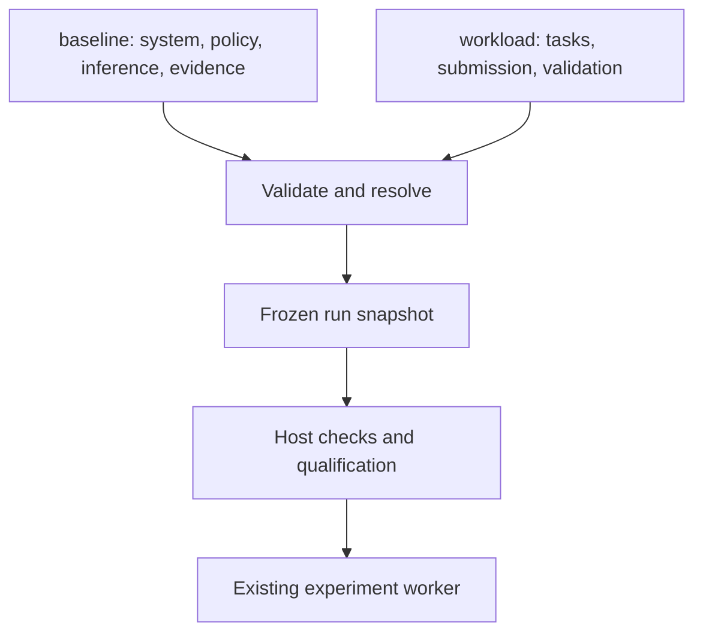

# Configuration ownership and option relationships

Every run has one baseline and one workload. A baseline selects one policy;
workload cases, concurrency levels and repetitions expand it into trials. A
comparison uses several baselines with the same workload. Fields have one owner
and are resolved directly from these two files.

## Ownership

| File/section | Responsibility |
| --- | --- |
| baseline `environment` | Runtime and default Tool templates/shapes; CPU/NUMA pools; physical and admission budgets; storage/cache/native settings |
| baseline `mechanisms` | Admission, runtime control, placement, idle reclaim, shared memory, checkpoint, prewarm, deployment and action selection |
| baseline `conditions`, `evidence` | Prediction source, trained artifacts and measured cost/sharing evidence |
| baseline `inference`, `agent` | Replay/API/serving simulator, model timing and agent integration |
| baseline `execution`, `measurement` | Creation/installation limits, timeouts, optional probes, sampling and stabilization |
| workload `tasks` | Task source/manifest or explicit cases; repetitions, assignment, rollouts per case, task-specific Tool templates |
| workload `submission` | Offered session levels, arrivals, randomization/seed, active-session bound and observation window |
| workload `validation` | Default final task check; individual cases may provide their own check |

Physical capacities, admission promises, configured guest sizes and measured
consumption are different quantities. Declaring capacity does not prove it is
available. Host preparation plans, credentials and immutable traces/KB files
remain supporting inputs. Baselines reference their verified resources; loading
configuration does not apply host plans, rebuild images or replace template IDs.

## Dependencies, independence and exclusions

?Independent? below means independently selectable, not additive performance.
Shared CPU, DRAM and disk budgets create interactions even between independent
switches. JSON Schemas list every field and default; validation checks cross-field
rules after combining the two files.

| Options | Relationship and reason |
| --- | --- |
| Admission `off/fixed/predicted` | Mutually exclusive strategies for Tool growth admission. Fixed needs a calibrated static MiB budget; predicted needs a matching prediction artifact. VM lifecycle admission remains separate. |
| Runtime memory protection / CPU release boost / proactive memory reclaim | Separate switches. CPU boost requires managed, fixed LOCAL placement. Their effects interact through CPU and memory pressure. |
| C0/C2/B | Mutually exclusive Tool CPU algorithms. C2/B require explicit compute pools, a VM cgroup and suitable host LLC topology. They are separate from initial NUMA placement. |
| B and memory admission | Independent choices in every prediction mode. Off/fixed does not require a memory estimate; fixed still reserves its configured MiB budget. Predicted admission still requires valid memory evidence. Missing provider is an error; a valid prediction without an eligible duration leaves that call unbound. |
| Control polling and measurement | Separate frequencies. C2/B use `tool_call_cpu_poll_interval_seconds` (0.25 s), not memory sampling. Set 1 s explicitly for historical Full C2. More measurements can still add overhead. |
| Placement `affinity/snapshot_aware` | Only implemented by `execution.snapshot_branching`; ordinary sessions reject them. Ordinary session policies are round_robin, explicit, load_aware and os_default. |
| `template_affinity` | A separate placement preference requiring physical template-sharing evidence. It is not the specialized branching `affinity` enum. |
| Idle reclaim `off/wait/gpu` | Mutually exclusive victim-selection strategies. `gpu` requires online serving_sim signals. |
| Idle reclaim scope `tool/agent_and_tool` | Selects which VMs can be parked. Both scopes work with wait or GPU selection. Pair scope adds Runtime checkpoint/restore cost. |
| GPU signals and reclaim | Signal consumption also serves next-use residency, page preparation or explicit prewarm. Those uses do not force the GPU victim-selection strategy. |
| `restore.prewarm_events` | Independent event list: empty (default), think_end, first_token or both. Requires snapshots and serving_sim. It works with wait/GPU reclaim and either scope; resident VMs are skipped. |
| Checkpoint full-copy/incremental-cow | Mutually exclusive encodings. Idle reclaim off makes checkpoint creation dormant, but the mapping mechanism still matters for base cache. |
| Compression none/zstd-page | Independent of the public full-copy/incremental-cow choice. Compressed snapshots require the installed native helper. Compression affects I/O and space costs. |
| Storage disk/warm-only/tiered | Mutually exclusive destinations. WARM requires a configured DRAM pool; disk requires COLD storage. Resident runs retain declared settings but perform no idle checkpoints. |
| Residency lru/value/next-use | Mutually exclusive replacement policies. Value and next-use require reclaim and tiered storage when active; value needs its measured cost model. Next-use additionally needs serving_sim, but not GPU reclaim or pair scope. |
| Page preparation | Requires serving_sim, incremental lineage, COLD/tiered internal storage and snapshot pause. Wait/GPU, Tool/pair, and compressed/uncompressed are accepted. Prefetching may contend with restore I/O. |
| Fixed template base cache | Requires incremental-cow private mappings and a prepared WARM pool; works with resident VMs. It is not a subset of idle reclaim. Preparation is host-wide for selected bases and must match the baseline. |
| Shared borrowing off/hard/pressure | Mutually exclusive borrowing policies, independent of whether snapshots exist. Borrowing needs a positive allowance and physical WARM pool. |
| Borrowing + WARM snapshots + base cache | Compete for the same physical shared pool. Disabling an operation does not remove the physical pool or expand another limit automatically. |
| Action selection context-first | Active Tool admission/progress uses borrow then one safe idle checkpoint fallback. Idle/model-wait pressure uses checkpoint then one live-VM borrow fallback. The actions are not compared with a shared cost score. |
| Deployment os-default | A deliberately bundled uncontrolled baseline: OS placement, no Tool admission/runtime controls/borrowing/affinity, resident VMs. This is not a general switch orthogonal to managed mechanisms. |
| Resident capacity accounting | Managed resident-only ledger; excludes snapshots and shared borrowing. Reservation scale in (0,1] requires this mode. Discounted reservations are promises, not measured RAM. |
| Non-home peer resume | Requires managed peer-local-SSD storage and pair reclaim; placement moves the VM pair. Tool-only migration is not implemented by that path. |
| CPU QoS | Managed placement/cgroup required; group-idle requires enabled QoS. Workload case labels determine which sessions get each class. |
| Grouped submission | Offered count must equal number of cases ? rollouts per case. Each group shares an arrival time; each rollout has separate VMs. Other assignments require rollouts_per_case=1. |
| Offered sessions / max active / creation / dependency-install limits | Different gates. Offered count specifies work; max active caps live sessions; creation caps VM startup; installation caps matching package commands. Any can become the throughput bottleneck. |

The remaining restrictions above describe actual implementation requirements or
a named experimental control, rather than accidental coupling. In particular,
OS-default and resident-capacity accounting are intentionally compound modes.
Changing them into arbitrary combinations would change the experiment method.

## Changing a configuration

Any baseline/workload change requires a new run ID. Policy thresholds, arrival
settings, polling and prewarm events do not by themselves require host apply,
image rebuild or retraining. Changed CPU pools/mounts/native services require host
check/apply; changed guest contents or shapes require suitable new templates;
changed predictor training inputs require a new artifact and matching provenance.
Keep task arrivals and replay timing fixed during a policy comparison.

`resolve` and `describe --json` expose effective settings before launch. Saved
limits remain explicit. Unsupported combinations fail before VM creation; they
are not silently replaced by a different algorithm. Historical schema 3/4 runs
are preserved on disk but are not accepted by the new launcher.
