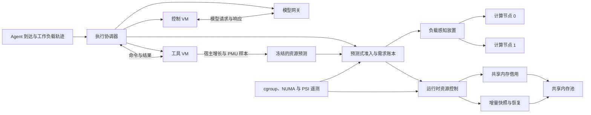
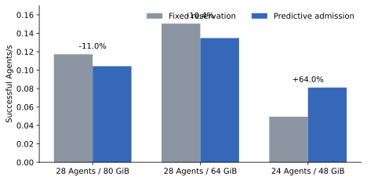
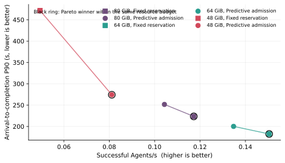
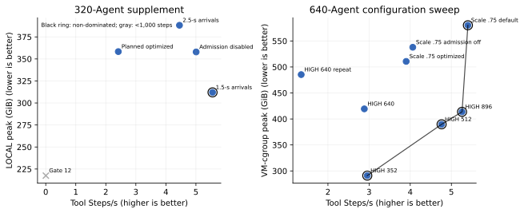
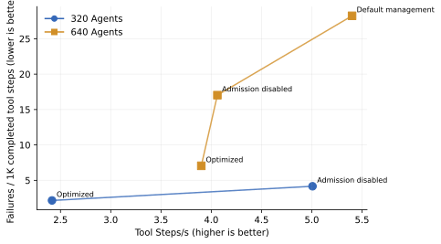
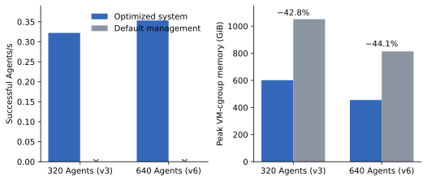
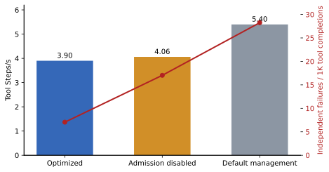
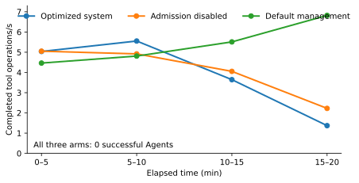
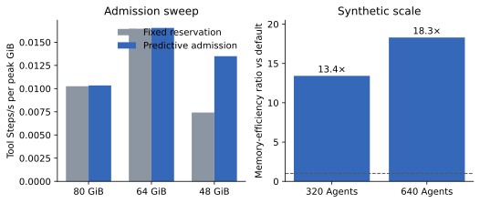
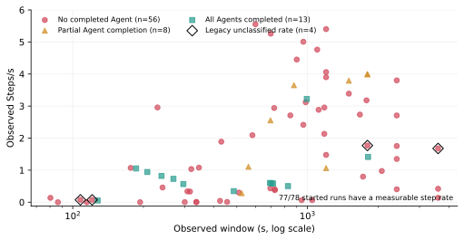

# 面向统一编址多计算节点环境的高密度 Agent 资源管理

## 摘要

Coding Agent 在执行过程中交替进行模型推理和工具调用，并为每个会话维护控制状态与可变工作区。大规模并发会同时放大内存超额承诺、节点间负载失衡、工具阶段突发增长和空闲 VM 长期驻留等问题。本文提出一个面向高密度 Agent 执行的资源管理系统，目标环境由多个统一编址的计算节点和一个共享内存池组成，节点间通过高速内存互连协作。当前原型在单台多 NUMA 节点服务器上实现这一抽象，以 NUMA 距离和内存放置模拟跨节点访问开销。系统为每个 Agent 配置相互隔离的控制 VM 与工具 VM，利用离线训练并冻结的逐命令内存预测实施准入控制，以各计算节点的实测驻留量和未兑现增长维护统一需求账本，并在压力下协调空闲 VM 的增量快照、共享内存借用和有界运行时控制。系统分别记录已驻留内存、尚未显现的命令增长、生命周期操作余量和共享池占用，从而在统一编址环境中控制并发增长。

我们在一台 ARM64 Kunpeng NUMA 服务器上评估该系统。受控异构内存负载表明，预测式准入控制的收益取决于争用强度：在 24 个并发 Agent、48 GiB 计算节点本地内存下，它相对固定 256 MiB 预留将 Agent 与工具吞吐均提高 64.0%（0.0495→0.0811 Agents/s；0.346→0.568 Tool Steps/s），并把到达至完成 P90 从 471.54 s 降至 274.24 s；在 64–80 GiB 的较宽松点，预测策略产生 10.4%–11.0% 的负收益。在近零模型等待的合成扩展实验中，完整优化系统分别在 993.18 s 和 1811.07 s 内完成 320/320 与 640/640 个 Agent，其 Tool Steps/s 分别达到默认资源管理的 7.67 倍和 10.24 倍，VM cgroup 峰值内存分别降低 42.8% 和 44.1%。真实轨迹呈现不同的资源边界：在新完成的 320-Agent 匹配实验中，禁用预测式准入将 Tool Steps/s 从 2.416 提高至 5.007，而 LOCAL 峰值均约为 358 GiB；两种配置均没有 Agent 完成，且全程没有内存 PSI 或 OOM，表明该点受执行容量限制。在既有 640-Agent、1200 s 匹配窗口中，完整优化系统、禁用预测式准入和默认资源管理分别维持 3.901、4.061 和 5.401 Tool Steps/s；完整系统以部分窗口吞吐换得更低峰值和更低失败密度。对 78 个已启动运行统一整理后，77 个具有可计算的观察窗 Steps/s，包括失败、取消和部分完成的实验。结果表明，预测式准入能够避免内存受限突发负载中的拥塞崩溃，但在执行容量主导时应及时放宽；快照恢复和共享内存借用还需降低高并发迁移成本。

## 1. 引言

Agent 服务的资源需求具有两个容易被传统容器或虚拟机调度器忽略的特征。第一，逻辑并发与瞬时执行并发并不相同：大量 Agent 可以同时存在，但其中相当一部分正在等待模型响应；当响应集中到达时，工具 VM 又会出现相关性很强的内存和 CPU 突发。第二，VM 的配置容量、宿主机当前驻留量以及下一条命令可能带来的增量需求是三个不同的量。仅依据 VM 规格限制并发会过度保守，仅依据当前驻留量放行则会在增长兑现前过度承诺。

系统面向具有统一内存编址和资源共享能力的多计算节点环境，在提高 Agent 吞吐的同时控制尾延迟与失败扩散。当前实现将多个 NUMA 域映射为计算节点，将独立 NUMA 域映射为共享内存池，并通过实际 NUMA 拓扑体现不同节点间的访问延迟和带宽差异。每个 Agent 使用一对 VM：控制 VM 承载 Agent 控制逻辑，工具 VM 保存可变工作区并执行命令。离线资源分析器在独立训练运行中测量命令级资源行为，正式实验使用冻结的宿主内存增长预测。每条工具命令开始前，控制器结合当前节点驻留、在途增长、生命周期余量和共享池额度执行准入；会话进入真实模型等待且出现内存压力时，控制器可成对暂停控制 VM 与工具 VM，将增量状态保存在共享内存池，并在响应或下一条命令到达时恢复。运行中的 VM 还可在受控额度内临时使用共享内存。所有动作使用同一原子账本，防止命令增长、恢复和借用重复承诺同一容量。

本文基于三天实验记录中的 73 个已启动实验/探索臂以及相应配置、事件、采样和操作明细，聚焦能够由现有数据直接支持的结论。我们的主要发现如下。

1. **预测准入存在明确的有效区间。** 在 48 GiB 的紧张点，逐命令预测相对固定预留把 Tool Steps/s 从 0.346 提高到 0.568，同时提高 64.0% Agents/s 并降低 41.8% 的到达 P90；当容量增至 64 或 80 GiB 时，同一策略造成约 10%–11% 的负收益。预测的价值来自避免不必要的串行化与欠估计之间的折中，而非无条件减少内存。
2. **组合式资源控制可以避免合成过载下的系统性停滞。** 在 320-Agent 和 640-Agent 合成负载中，完整优化系统的 Tool Steps/s 分别达到默认资源管理的 7.67 倍和 10.24 倍，并完成全部 Agent；默认配置在一小时内没有成功 Agent。完整优化系统还将 VM cgroup 峰值内存降低约 43%–44%。这些实验验证了预测、准入、受控部署和 NUMA 放置的组合路径；快照与借用未在这两组实验中激活，其独立贡献不计入上述收益。
3. **真实轨迹揭示了执行容量与内存控制的分界。** 新的 320-Agent 匹配实验中，禁用预测式准入将 Tool Steps/s 提高 107.3%，但失败密度从 2.16 增至 4.16 次/千步；两者具有相同的约 358 GiB LOCAL 峰值，均未出现内存 PSI 或 OOM。该轨迹若要在 960 s 内达到 95% 完成率，至少需要 7.60 Tool Steps/s，快于最快配置的 5.01 Tool Steps/s。准入是执行进展的重要限制因素，但总执行容量决定了该点无法产生 Agent 完成。
4. **未完成运行提供了可复用的窗口吞吐证据。** 本文为失败、取消和部分完成的运行统一计算观察窗 Steps/s，并将吞吐与窗口长度、内存峰值和失败密度联合分析。全部 78 个已启动运行中，77 个具有可测的步骤率；这一口径补充端到端 Agents/s，使异常和边界运行也能用于定位资源瓶颈与构造多目标帕累托前沿。

## 2. 系统概述

### 2.1 系统架构

图 1 展示系统的数据面与控制面。多个计算节点在统一编址空间中协同运行 Agent 工作负载，共享内存池为跨节点内存借用和快照存储提供公共容量。每个会话拥有一对独立 VM；模板可以复用，运行状态和工作区保持隔离。实验驱动器按固定到达序列创建会话，通过模型网关重放真实等待，并经 SSH 在工具 VM 中执行命令。离线资源分析器采集命令级内存与 PMU 数据，正式运行使用冻结的预测工件。资源控制器读取 VM cgroup、NUMA 驻留、PSI 和生命周期状态，统一驱动准入、放置、共享内存借用与快照恢复。

**图 1：系统架构。** 多个计算节点通过统一编址访问本地与共享内存；控制器在同一容量模型中协调命令增量需求、运行 VM、跨节点借用与快照，控制 VM 和工具 VM 的生命周期由同一会话状态机管理。

### 2.2 运行流程

对于受控工具命令，系统首先根据固定额度或冻结的逐命令预测计算额外宿主内存需求，再把该需求与当前实测驻留、已授予但尚未兑现的增长以及安全余量相加。当候选计算节点仍低于准入高水位时，控制器授予执行标识；超出水位的请求进入准入队列。工具 VM 如处于暂停状态，系统先预留恢复容量、恢复 VM、重新解析可能变化的 SSH 端点，再执行一次命令。命令退出并完成测量后释放增量预留。创建和恢复阶段按 VM 配置容量保守预留，直到 cgroup 采样反映相应增长。

模型调用期间，网关保持一个真实未完成请求。请求仍未完成、没有工具命令在途且存在内存压力时，会话进入空闲回收候选集合。系统在暂停控制 VM 和工具 VM 之前为整对快照预留共享池容量；模型响应到达后先恢复控制 VM 并交付响应，工具 VM 可延迟到下一条命令前恢复。该顺序消除了响应到达与快照提交并发时的生命周期竞态。

## 3. 设计

### 3.1 预测式准入控制

系统将命令准入建模为增量需求控制。对命令 $i$，控制器使用冻结的宿主增长预测 $\hat{g}_i$，并乘以统一校准系数；固定预留基线对所有命令使用相同额度。对候选计算节点 $n$，准入条件为

$$
M_n^{resident} + M_n^{pending} + \hat{g}_i + H_{admission} \le H_n,
$$

其中，$M_n^{resident}$ 表示实测驻留，$M_n^{pending}$ 表示已经授予但尚未在测量中显现的增长，$H_{admission}$ 表示公共安全余量，$H_n$ 表示节点准入高水位。已驻留页面不再计入命令增量；非命令工具操作使用公共固定预算；缺失预测采用显式回退额度。该设计允许小命令在紧张内存下继续推进，同时阻止多个大命令在采样追上前同时兑现增长。

### 3.2 负载感知放置与统一内存记账

每个计算节点分别维护本地内存容量、低水位、高水位和 CPU 承诺。负载感知放置先检查 CPU 超额承诺与本地内存安全，再选择压力较低的节点，并将同一 Agent 的控制 VM 与工具 VM 协同放置。共享内存池同时承载运行 VM 的临时借用页与内存快照，二者共用一份池级账本。VM 父 cgroup 的硬上界等于各计算节点本地容量之和加全局借用上限，共享池容量由运行内存和快照共同竞争。

记账模型区分物理驻留、容量预留和 VM 配置容量。内存绑定变化后，既有页面逐步迁移；控制器因此以 `memory.numa_stat` 的实测驻留进行控制与报告。无法归属的内存对每个节点的局部准入保守计入，在宿主总量中只计一次。当前实验覆盖负载感知放置与轮询放置，匹配的放置消融结果保留为 TODO。

### 3.3 空闲 VM 快照与恢复

等待模型响应时，驻留的工具 VM 通常没有命令执行，却继续占用宿主内存。系统在真实模型请求未完成且存在内存压力时回收这部分容量。增量写时复制快照保存模板基底之外的变化范围；内存快照存入共享内存池上的 tmpfs，并在恢复时按需载入页面。复制期间源 VM 与目标快照会同时占用容量，因此系统在操作前预留 VM 配置内存与恢复余量，并限制全池并发传输数。

控制器根据释放容量和服务成本选择快照回收或共享内存借用。规模实验表明，低负载校准会显著低估高并发下的快照与恢复时间；实验分析因此同时报告动作次数、释放容量、服务时延和最终吞吐。

### 3.4 共享内存借用

当计算节点接近准入高水位时，运行 VM 可以在全局上限内临时使用共享内存，从而让关键命令继续执行。借用前按 VM 配置容量预留共享额度，以覆盖后续增长；归还本地内存后，仍然存在的共享驻留页继续占用相应预留。借用与快照竞争同一物理池，因此借用上限、快照预留、已提交快照和延迟恢复引用由同一个原子账本管理。该机制提高了节点间内存利用弹性，同时引入跨 NUMA 域迁移与归还延迟。

### 3.5 有界运行时资源控制

运行时资源控制与预测式准入相互独立。控制器在观测到内存 PSI 与回收扫描时，为活动工具 VM 临时设置有界 `memory.low`；当准入受阻、CPU PSI 升高，且历史记录显示相同模板与命令能够释放宿主瞬时内存时，控制器临时提高 cgroup CPU 权重。主动缓存回收构成第三类动作。所有动作在短窗口后恢复默认值，并受全局预算、冷却时间和 VM 代次校验约束。现有规模结果中的内存保护和 CPU 加速动作计数为零，相应性能贡献保留为 TODO。

## 4. 实现

系统通过独立实验驱动器管理 VM 沙箱，无需集群编排平台。控制器使用 cgroup v2 的 CPU、memory 与 cpuset 接口；每个 VM 在创建或恢复分配内存前进入稳定的优先级控制组。一次 Agent 请求创建一个 2-vCPU/2-GiB 控制 VM 和一个 2-vCPU/4-GiB 工具 VM。命令执行、准入和测量由全局执行标识关联，恢复后重新解析 SSH 端点，防止端点变化导致重复执行。

离线资源分析器在工具 VM 中通过 `perf_event_open` 收集 CPU 周期、指令数、末级缓存读取和读取缺失，并同时记录 VM 内部环境增量与宿主 cgroup 增长。正式运行只读取独立训练后冻结的预测文件。四个 PMU 事件均受支持、执行标识匹配且 running/enabled 达到 100% 时，相应记录进入缓存分析；内存预测不依赖 PMU 数据可用性。

扩展实验还暴露了一项 VM 创建路径瓶颈：旧实现每创建一个 VM 都扫描宿主全部进程两次，以重新发现已知 cgroup；常驻 VM 监控进程增加后，单 VM P95 创建时间达到约 111–115 s。直接验证并复用预分配控制组后，32-Agent 配置的 64 个 VM 在 28.45 s 内全部创建，随后 320-Agent 配置的 640 个 VM 在 143.06 s 内无错误创建。该优化消除了实验基础设施瓶颈，使高密度资源策略能够进入稳定执行阶段。

## 5. 实验方法

### 5.1 硬件与资源配置

实验运行在一台 ARM64 Kunpeng NUMA 服务器上，内核为 `6.6.0-72.0.0.76.oe2403sp1.aarch64`。主要规模实验将 CPU 0–159 及 NUMA 0/1 映射为两个计算节点，CPU 160–319 留给控制与支持服务，NUMA 2 映射为共享内存池。主机约有 1007 GiB 物理内存。受控规模配置为计算节点提供 928 GiB 本地内存预算，为共享池提供 384 GiB 容量，并将跨节点实时借用上限设为 192 GiB；VM 父 cgroup 的总驻留上限为 1120 GiB。默认资源管理基线使用相同的 160-CPU 范围和 1120-GiB VM cgroup 总预算，关闭预测式准入、负载感知放置、运行时资源控制、空闲回收和共享内存借用。配置记录沿用 `LOCAL` 表示计算节点本地内存，`WARM` 表示共享池中的快照容量，`LOW/HIGH` 表示触发回收和限制准入的策略水位。

较小的准入实验分别使用 48、64 和 80 GiB 计算节点本地内存，控制 VM 与工具 VM 的规格保持 2 GiB 和 4 GiB。规模实验分别运行 320 和 640 个 Agent，完全驻留时需要 640 和 1280 个 VM。成对 VM 创建并发根据实验阶段设为 8 或 16；并发 16 在真实轨迹、快照与创建重叠时产生供给不稳定，后续配置固定为 8。

| 实验族 | Agent / VM 数 | CPU 范围 | 本地容量 / 准入高水位 | 共享池 / 借用上限 | 到达与负载特征 |
|---|---:|---|---|---|---|
| 准入策略扫描 | 24–28 / 48–56 | 受控小规模域 | 48/44、64/60、80/76 GiB | 128 GiB / 关闭 | 同时到达；异构命令表 |
| 合成规模实验 | 320–640 / 640–1280 | 0–159 | 928/864 GiB | 384/192 GiB | 50 ms 间隔；近零 LLM 等待 |
| 真实轨迹高压实验 | 320 / 640 | 0–159 | 928/160 GiB | 384/192 GiB | 50 ms 间隔；25 个真实等待 |
| 真实轨迹匹配实验 | 640 / 1280 | 0–159 | 928/640 GiB | 384/192 GiB | 2 s 间隔；25 个真实等待 |
| 真实轨迹补充实验 | 320 / 640 | 0–159 | 928/448 GiB | 256/64 GiB | 0.5 s 间隔；24 次工具调用；960 s |

**表 1：主要实验配置。** 共享内存借用与内存快照共用同一共享池，表中的共享池容量和借用上限不构成两份独立执行容量。

### 5.2 工作负载

**受控异构内存负载。** 24/28-Agent 实验重放具有不同内存增量的命令表，用于比较固定 256 MiB 预留与逐命令预测。320-Agent 轨迹包含十个工具阶段，640-Agent 轨迹包含四个阶段；二者的模型等待总计仅 0.11 s 和 0.05 s，用于构造近零思考时间的突发边界。两个规模点具有不同任务长度，本文分别报告 Agents/s 与 Tool Steps/s。

**真实 Agent 轨迹。** sqlglot 工作区回放包含 25 个真实模型等待，累计 177.504 s，单次等待为 1.91–14.97 s，时间缩放系数为 1；工具命令在真实 VM 中重新执行。原始记录全程约 567.65 s，其中 390.15 s 为工具与 Agent 处理，每个 Agent 在最终响应前需要完成 24 次工具调用。既有 640-Agent 匹配比较使用 2 s 到达间隔、512/640 GiB 本地内存低/高水位、928 GiB 本地内存硬上限、384 GiB 共享池和 0.75 的预测预留缩放系数。最后一个请求计划在 1278 s 到达，因此 1200 s 观察窗刻画持续到达阶段的执行吞吐。

新的 320-Agent 补充实验使用 0.5 s 到达间隔、384/448 GiB LOW/HIGH 水位、256 GiB WARM 容量、64 GiB 借用上限和 8 路 VM 创建并发。计划内的完整优化系统与禁用预测式准入配置均运行 960 s。另有三个预先限定终止条件的配置校准：将 LOW/HIGH 放宽至 448/512 GiB 并把创建并发提高到 12；保持 8 路创建并将到达间隔放慢至 1.5 s；以及进一步放慢至 2.5 s。校准实验在预声明的 95% 完成目标已不可能达到时终止。

### 5.3 基线与消融配置

| 配置 | 工具准入 | 放置策略 | 空闲快照 | 共享内存借用 | 运行时控制 | 实验目的 |
|---|---|---|---|---|---|---|
| 固定内存预留 | 每命令固定额度 | 受控放置 | 关闭 | 关闭 | 公共设置 | 准入控制基线 |
| 预测式准入控制 | 逐命令预测 | 受控放置 | 小规模实验关闭 | 关闭 | 公共设置 | 预测相对固定预留的贡献 |
| 完整优化系统 | 逐命令预测 | 负载感知 NUMA 放置 | 压力触发、双 VM 成对回收 | 压力触发 | 开启 | 组合优化效果 |
| 禁用预测式准入控制 | 关闭 | 与完整优化系统相同 | 与完整优化系统相同 | 与完整优化系统相同 | 与完整优化系统相同 | 准入控制消融 |
| 默认资源管理 | 关闭 | 操作系统默认放置 | 关闭 | 关闭 | 关闭 | 端到端系统基线 |
| 禁用空闲快照 | 与完整优化系统相同 | 与完整优化系统相同 | 关闭 | 与完整优化系统相同 | 与完整优化系统相同 | **TODO** |
| 禁用共享内存借用 | 与完整优化系统相同 | 与完整优化系统相同 | 与完整优化系统相同 | 关闭 | 与完整优化系统相同 | **TODO** |
| 使用轮询放置 | 与完整优化系统相同 | NUMA 轮询 | 与完整优化系统相同 | 与完整优化系统相同 | 与完整优化系统相同 | **TODO** |
| 禁用动态资源控制 | 与完整优化系统相同 | 与完整优化系统相同 | 与完整优化系统相同 | 与完整优化系统相同 | 关闭 | **TODO** |

**表 2：基线与消融。** “禁用预测式准入控制”只移除工具准入，可直接衡量准入贡献；“默认资源管理”同时关闭全部优化，用于整体系统比较。

### 5.4 指标

Agent 成功吞吐以完整观察窗内通过最终验证的 Agent 数计算，观察窗包含创建和排队。成功率分母为全部计划请求。Tool Steps/s 表示 Agent 工具路径中完成的底层工具操作数/秒，包含非零退出，并可能将一条高层调用展开为多次执行。该指标衡量执行层吞吐；实验尚未完成全部 Agent 时，观察窗口内的 Tool Steps/s 仍作为正式结果保留。对执行作用域尚未写入事件的四个早期运行，本文单独报告未分类命令 Steps/s，不将其混入应用工具吞吐。只有 1 个持续 1.92 s、未产生可分类工具计数的启动点没有步骤率。本文同时给出固定五分钟分箱，用于识别预热、爬升和衰退。时延分别报告执行开始至完成、以及计划到达至完成的分位数。

CPU 均值由 VM 父 cgroup 累计 CPU 时间归一化，内存峰值为离散采样峰值。完整优化系统分别记录计算节点本地驻留、共享运行内存与共享池快照；默认资源管理的历史数据提供 VM cgroup 总内存，因此跨配置比较统一采用 VM cgroup 峰值。每个实验还记录 OOM、PSI、创建与准入排队、借用与归还次数、快照与恢复次数及其服务时延。

## 6. 实验结果

### 6.1 预测式准入控制的适用区间

**结论：预测准入只在固定预留无法表达命令异质性、且内存足够紧张时产生显著收益。** 图 2 和表 3 给出三个匹配点。所有实验均完成全部 Agent、无 OOM，并使用相同 2/4-GiB VM 规格。

在无明显内存压力的 8-Agent 预实验中，预测与三个固定/缩放配置仅相差不到 3%（0.704 对 0.685–0.698 Agents/min），说明此时具体预留值不是主导瓶颈。随着并发提高，容量位置决定了预测能否抵消其控制开销。

| 并发 / 本地内存 | Agents/s：固定预留 → 预测准入 | Tool Steps/s：固定预留 → 预测准入 | Steps/s 变化 | 到达 P90：固定预留 → 预测准入 | 本地内存峰值：固定预留 → 预测准入 |
|---|---:|---:|---:|---:|---:|
| 28-Agent / 80 GiB | 0.1172 → 0.1043 | 0.821 → 0.730 | −11.0% | 223.56 → 251.61 s | 80.00 → 70.58 GiB |
| 28-Agent / 64 GiB | 0.1505 → 0.1348 | 1.053 → 0.943 | −10.4% | 182.37 → 200.13 s | 64.00 → 57.02 GiB |
| 24-Agent / 48 GiB | 0.0495 → 0.0811 | **0.346 → 0.568** | **+64.0%** | **471.54 → 274.24 s** | 46.66 → 42.07 GiB |

**表 3：预测准入的压力敏感性。** 数字使用统一的启动至终止窗口；原结果工作负载窗口下 24-Agent 配置的提升为 66.5%。

在 48 GiB 点，预测策略同时提高吞吐、把到达 P90 降低 197.30 s（41.8%），并把峰值 LOCAL 降低 4.59 GiB（9.8%）。固定策略的准入等待 P90 达到 34.00 s，预测策略仅为 0.13 s，说明统一的 256 MiB 额度在异质命令组合中造成了不必要的串行化。预测策略以更准确的增量额度允许小命令穿过拥塞区间，在降低峰值内存的同时减少排队。

在 64 和 80 GiB 点，内存压力不足以补偿预测准入与执行次序变化的开销。预测策略虽然分别降低约 7.0 和 9.4 GiB 峰值内存，却使完成时间变长。这两个负结果将预测式准入的适用区间明确限定在高密度资源争用场景。

三组工作负载中每个 Agent 都执行七个底层工具操作，因此 Agents/s 与 Tool Steps/s 的相对变化一致；Tool Steps/s 同时给出了实际执行工作量。在 48 GiB 点，预测策略的 Tool Steps/s/peak-GiB 从 0.00742 提高到 0.01350，提升 81.9%。64/80 GiB 两点的该效率几乎不变（变化均小于 1%），说明预测策略在那里主要以等比例降低工作推进和峰值内存，没有产生新的资源效率收益。

### 6.2 吞吐—长尾帕累托前沿

**结论：在相同资源预算内，48 GiB 的预测策略同时改善吞吐和长尾；64/80 GiB 的固定策略同时改善二者。** 图 3 以成功 Agents/s 为横轴、到达至完成 P90 为纵轴。黑圈标出每个相同并发/内存预算内的非支配点。跨预算连接会把内存容量和并发差异混入策略效果，因此本文不构造一个跨 48/64/80 GiB 的全局前沿。

该组工作负载固定为每个 Agent 七次工具操作，因此把横轴乘以 7 即得到 Tool Steps/s，非支配关系完全不变；表 3 已给出对应值。图中保留 Agents/s 横轴，以便与 Agent 级 P90 使用相同完成单位。

| 资源点 | 帕累托最优配置 | 吞吐优势 | P90 优势 | 解释 |
|---|---|---:|---:|---|
| 28-Agent / 80 GiB | 固定内存预留 | 比预测准入高 12.4% | 低 28.05 s | 宽松点上预测控制无收益 |
| 28-Agent / 64 GiB | 固定内存预留 | 比预测准入高 11.6% | 低 17.76 s | 固定额度尚未造成关键阻塞 |
| 24-Agent / 48 GiB | 预测式准入控制 | 比固定预留高 64.0% | 低 197.30 s | 异质命令与紧内存使预测同时改善两项目标 |

在 320-Agent 和 640-Agent 合成实验中，完整优化系统具有非零成功吞吐和有限的到达 P90，而默认资源管理没有完成 Agent，其尾延迟为右删失值。因此，完整优化系统在各自资源点上占优，但默认配置没有可绘制的数值 P90。真实轨迹没有 Agent 完成，无法构造完成延迟前沿；其数千次工具调用仍可用于构造窗口吞吐—内存和窗口吞吐—失败密度前沿。

图 3b 汇总两个真实轨迹配置空间。为避免纯启动阶段的极低内存点扭曲前沿，帕累托候选要求观察窗内至少完成 1000 次应用工具调用；所有低于该阈值的运行仍以灰色标记保留。新的 320-Agent 补充实验中，1.5 s 到达配置以 5.553 Tool Steps/s 和 312.0 GiB LOCAL 峰值同时支配另外三个有效进展点；创建并发为 12 的配置只完成一次工具调用，217.5 GiB 峰值来自尚未形成应用负载。640-Agent 配置扫描形成四段前沿：352 GiB 高水位配置为 2.956 Steps/s、291.0 GiB，512 GiB 配置为 4.762 Steps/s、389.7 GiB，896 GiB 配置为 5.259 Steps/s、413.7 GiB，默认资源管理以 580.2 GiB 达到最高的 5.401 Steps/s。该前沿直接显示，放宽水位最初能同时改善吞吐和资源效率，继续追求最高窗口吞吐则需要显著增加驻留内存。

图 3c 进一步把匹配配置投影到吞吐—失败密度平面。320-Agent 完整优化系统和禁用预测式准入分别达到 2.416/5.007 Steps/s 与 2.16/4.16 次失败/千步；640-Agent 的完整系统、禁用准入和默认管理依次为 3.901/7.05、4.061/17.03 和 5.401/28.24。每组配置均位于各自的二维前沿：更高的窗口吞吐伴随更高失败密度。与只报告最高 Steps/s 相比，这一前沿揭示了准入控制在执行容量不足时仍能限制失败扩散。

### 6.3 合成过载下的整体系统性能

**结论：在近零思考间隔的合成负载上，完整优化系统避免了默认资源管理下的进度崩溃，并将峰值 VM 内存降低约 43%–44%。** 320-Agent 与 640-Agent 配置分别完成 320/320 和 640/640 个 Agent；默认资源管理在 3600 s 内均无成功 Agent。其成功吞吐为零，因此表 4 直接报告执行层吞吐比，不把端到端收益表示为有限加速比。

| 工作负载 | 资源管理策略 | 成功/目标 | 窗口 | Agents/s | Tool Steps/s | 到达 P90 | VM cgroup 峰值 |
|---|---|---:|---:|---:|---:|---:|---:|
| 320-Agent v3 | 完整优化系统 | 320/320 | 993.18 s | 0.3222 | 3.222 | 923.31 s | 601.11 GiB |
| 320-Agent v3 | 默认资源管理 | 0/320 | 3600 s | 0 | 0.420 | — | 1051.31 GiB |
| 640-Agent v6 | 完整优化系统 | 640/640 | 1811.07 s | 0.3534 | 1.414 | 1737.01 s | 455.14 GiB |
| 640-Agent v6 | 默认资源管理 | 0/640 | 3600 s | 0 | 0.138 | — | 813.55 GiB |

**表 4：合成规模边界。** 320-Agent v3 和 640-Agent v6 的阶段结构不同，表中并列用于展示两个已验证密度点，不用于计算横向扩展效率。

在 320-Agent 实验中，完整优化系统的峰值内存比默认资源管理低 450.20 GiB（42.8%），工具进展率为其 7.67 倍；640-Agent 实验中的对应差异为 358.41 GiB（44.1%）和 10.24 倍。两个完整优化配置均没有 OOM、Agent 失败或遥测丢失。640-Agent 默认配置发生 164 个独立失败，其中 148 个为沙箱资源耗尽，且存储使用越过 85% 保护阈值。该结果刻画了默认部署的端到端过载边界，性能差异来自准入、放置和受控部署的共同作用。

320-Agent v3 中每个成功 Agent 包含十个工具阶段，640-Agent v6 只有四个。因此 640-Agent 的 Agents/s 略高（0.353 对 0.322），其 Tool Steps/s 却只有 1.414，低于 320-Agent 的 3.222。跨工作负载比较时，Agents/s 会受到任务长度影响，Tool Steps/s 更直接地反映实际工作量。按 Tool Steps/s/峰值 VM cgroup GiB 计算，完整优化系统相对默认资源管理的效率在两个规模上分别提高 13.4 倍和 18.3 倍；按平均 VM CPU 核数归一化，分别提高约 6.5 倍和 11.6 倍。执行层数据表明，受控配置把更多计算和内存转化为了有效工具进展。

这两组实验中的共享借用、快照和恢复计数均为零，因而其收益来自预测式准入、受控部署与 NUMA 放置的组合。320-Agent 的创建队列 P90 仍为 646.75 s，640-Agent 达到 1536.31 s，说明 VM 供给排队仍占端到端延迟的较大比例；系统的核心收益体现在避免过载崩溃并保证任务最终完成。

### 6.4 真实轨迹过载下的窗口吞吐

#### 6.4.1 新增 320-Agent 匹配实验与容量校准

**结论：在 384/448 GiB 水位下，预测式准入将失败密度降低近一半，却把 Tool Steps/s 从 5.007 限制到 2.416；该点的主导瓶颈是执行容量。** 完整优化系统与禁用预测式准入配置使用相同 960 s 窗口、0.5 s 到达间隔和 8 路创建并发。禁用准入使工具吞吐提高 107.3%，LOCAL 峰值从 358.3 GiB 微降至 357.9 GiB，说明额外进展没有触发更高的本地内存压力。完整系统发生 5 次失败，禁用准入发生 20 次；归一化后分别为 2.16 和 4.16 次失败/千次工具完成。完整系统由此用约一半的执行吞吐换得 48.2% 更低的失败密度。

| 配置 | 关键差异 | 窗口 | 已创建会话 | 成功/失败 Agent | 工具完成数 | Tool Steps/s | LOCAL 峰值 | 内存动作 |
|---|---|---:|---:|---:|---:|---:|---:|---|
| 完整优化系统 | LOW/HIGH 384/448 GiB，WARM 256 GiB，借用 64 GiB，创建并发 8，0.5 s 到达 | 960 s | 293/320 | 0/5 | 2319 | **2.416** | 358.3 GiB | 11 次借用、8 次暂停、4 次恢复 |
| 禁用预测式准入控制 | 仅关闭工具准入，其余与完整系统相同 | 960 s | 289/320 | 0/20 | 4807 | **5.007** | 357.9 GiB | 8 次借用、4 次暂停、3 次恢复 |
| 提高创建并发 | LOW/HIGH 448/512 GiB，共享池 512 GiB，创建并发 12 | 300 s | 191/320 | 0/0 | 1 | 0.003 | 217.5 GiB | 无 |
| 1.5 s 到达校准 | LOW/HIGH 448/512 GiB，创建并发 8 | 600 s | 259/320 | 0/26 | 3332 | **5.553** | 312.0 GiB | 无 |
| 2.5 s 到达校准 | LOW/HIGH 448/512 GiB，创建并发 8 | 900 s | 286/320 | 0/37 | 4007 | **4.452** | 388.2 GiB | 无 |

**表 5：320-Agent 补充真实轨迹实验。** 前两行构成匹配比较，后三行为有界配置校准；所有吞吐均按完整观察窗计算。五个运行均无采样内存 PSI 和 cgroup OOM。

该轨迹每个 Agent 需要 24 次工具调用，960 s 内达到 95% 完成率至少要推进 $304\times24=7296$ 次调用，即 7.60 Tool Steps/s。最快的匹配配置达到 5.007 Steps/s，仅为目标速率的 65.9%；完整系统达到 31.8%。即使忽略最终响应与验证开销，按已观测速率完成 7296 次调用也需要约 1457 s。零内存压力、低于 LOW 水位的峰值以及这一工作量下界共同表明，调整内存水位、WARM 容量或借用策略无法在当前 160 CPU 上满足 960 s 完成目标。

三个校准点进一步分离了创建与执行瓶颈。将创建并发提高到 12 引发 VM 创建与后端维护风暴，300 s 内只完成一次应用工具调用。把到达间隔放慢到 1.5 s 后，吞吐提高到全部 78 个运行中的最高值 5.553 Steps/s，且峰值仅为 312.0 GiB；进一步放慢到 2.5 s 后，早期 VM 创建更充分，但累积负载仍产生 37 次 HTTP 408，平均吞吐降至 4.452 Steps/s。校准实验在预声明的 95% 完成目标已不可能达到时停止，其完整观察窗吞吐用于刻画容量边界。

#### 6.4.2 640-Agent 匹配窗口与配置扫描

**结论：未完成的真实轨迹实验仍给出了可比较的执行层吞吐；在匹配的 1200 s 窗口内，默认资源管理的 Tool Steps/s 最高，完整优化系统以部分窗口吞吐换取更低的内存峰值和失败密度。** 完整优化系统、禁用预测式准入控制和默认资源管理均未完成 Agent，但分别执行 4681、4873 和 6481 个底层工具操作，对应 3.901、4.061 和 5.401 Tool Steps/s。三者的 VM cgroup 峰值分别为 510.68、537.90 和 580.23 GiB。完整优化系统相对禁用准入控制降低 5.1% 峰值内存，同时执行层吞吐低 3.9%；默认资源管理相对完整优化系统的窗口吞吐高 38.5%，峰值内存也高 13.6%。三种方法由此形成清晰的内存—窗口吞吐权衡。

将独立失败按已完成工具操作归一化后，完整优化系统、禁用预测式准入控制和默认资源管理分别为 7.05、17.03 和 28.24 次/千次工具完成。完整优化系统相对默认资源管理降低 75.0%，相对禁用准入控制降低 58.6%。因此，默认资源管理的 38.5% Tool Steps/s 优势伴随约四倍的失败密度；完整优化系统在该窗口内将资源峰值和执行风险控制在更低水平。该指标合并了创建与会话阶段的失败，用于比较系统级行为趋势。

图 6 给出固定五分钟分箱。三种配置在每个区间都有持续工具进展，验证了全窗 Tool Steps/s 作为平均吞吐指标的有效性，同时揭示了明显的阶段变化。完整优化系统从 5–10 分钟的 5.553 steps/s 降至最后五分钟的 1.370 steps/s，下降 75.3%；默认资源管理从最初五分钟的 4.463 增至最后五分钟的 6.820，上升 52.8%；禁用预测式准入控制介于两者之间。完整优化系统在后期更强的准入抑制解释了其较低内存峰值、较低失败密度以及较低窗口吞吐。

其他未完成点也提供了有价值的执行层证据。早期 320-Agent 完整优化系统的两次长窗实验分别达到 3.995 和 3.992 Tool Steps/s，并完成 98/320 与 83/320 个 Agent；仅使用固定并发限制的配置为 3.793 Tool Steps/s、5/320 完成。前者的工具吞吐只高 5.2%–5.3%，成功 Agent 数却提高一个数量级，说明接近 4 Steps/s 时，推进顺序和尾部收敛比平均操作率更能决定端到端完成。另一组运行 875.45 s 后终止的预测式准入实验完成 308/320 个 Agent，达到 3.652 Tool Steps/s 和 0.3518 Agents/s，构成该机制的近完成性能点。

640-Agent 真实轨迹的配置探索进一步给出如下吞吐地图。这些点用于识别水位、到达速率和预测缩放的作用方向。

| 低/高水位（GiB） | 到达间隔 | 预测缩放 | 窗口 | Tool Steps/s | VM 峰值（GiB） | 快照 / 借用 | 解释 |
|---|---:|---:|---:|---:|---:|---:|---|
| 320/352 | 2.0 s | 1.0 | 1179 s | 2.956 | 291.0 | 50 / 10 | 迁移动作活跃，恢复成本限制进展 |
| 448/512 | 1.0 s | 1.0 | 1100 s | 4.762 | 389.7 | 0 / 6 | 中等水位取得较高窗口吞吐 |
| 512/640 | 0.5 s | 1.0 | 2400 s | 2.708 | 515.8 | 4 / 17 | 密集到达带来持续过载与 265 次失败 |
| 512/640 | 2.0 s | 1.0 | 1115 s | 2.884 | 419.4 | 0 / 0 | 较慢到达改善重叠，但提升有限 |
| 512/640 | 2.0 s | 1.0 | 2400 s | 1.350 | 485.3 | 0 / 0 | 重复点显示较大运行间波动 |
| 768/896 | 2.0 s | 1.0 | 697 s | **5.259** | 413.7 | 0 / 0 | 宽松准入水位给出最高窗口吞吐 |
| 512/640 | 2.0 s | 0.75 | 1200 s | **3.901** | 510.7 | 0 / 2 | 缩小预测预留后比两个缩放系数为 1.0 的点更快 |

同为 2 s 到达间隔时，高水位为 896 GiB 的配置达到 5.259 Steps/s，比 352 GiB 高水位配置高 77.9%，说明过紧的策略水位会先于 928 GiB 物理容量限制执行。高水位为 640 GiB、预测缩放为 0.75 的配置达到 3.901 Steps/s，比相同高水位、缩放为 1.0 的两个运行中的较好值仍高 35.3%，表明降低预测预留可解除部分保守准入。两个相同水位、到达间隔和预测缩放的运行相差 53.2%，说明该区域存在较强的运行间波动；水位变化的方向性结论仍然清晰。

在 2 s 到达间隔下，最后一个 640-Agent 请求于 1278 s 到达，晚于 1200 s 观察窗。因此这些结果刻画的是持续到达期间前 20 分钟的压力与执行进展；全量完成结果保留为 TODO。

### 6.5 快照恢复与共享内存借用

**结论：快照恢复和共享内存借用已在高压实验中激活，但迁移服务时间抵消了容量回收收益。** 320-Agent 的 128/160-GiB 高压实验在 2400 s 内记录 236 次成功 VM 快照（控制 VM 与工具 VM 各 118 次）、225 次恢复和 72 次借用，但没有 Agent 完成。工具 VM 快照的平均/P90 为 6.16/16.01 s，控制 VM 为 4.18/8.49 s；对应恢复时间分别为 14.38/41.43 s 和 13.33/29.30 s。过紧水位触发了反复迁移，使回收容量未能转化为端到端完成。

640-Agent 的 320/352-GiB 水位配置执行 50 次快照、43 次恢复和 10 次借用。工具 VM/控制 VM 的快照时间平均约 11.61/11.89 s，恢复时间平均约 42.58/36.92 s，恢复 P90 均约 78 s。该点在 1179.40 s 内完成 3486 个工具操作，但没有 Agent 完成。恢复长尾已占单次模型等待总量的显著比例，直接限制了端到端收益。

成本模型的误差进一步放大了迁移开销。在预测缩放为 0.75 的 640-Agent 配置中，两次工具 VM 借用的实测服务时间为 65.03 s 与 20.48 s，归还为 61.50 s；配置模型对 4 GiB 借用的估计仅约 0.263 s。低负载测得的动作成本在高并发下低估两个数量级，导致协调器偏向实际代价过高的迁移动作。这一结果要求按负载区间在线校准快照和借用成本。

### 6.6 资源利用率与调度开销

预测式准入的主要资源效果是压低峰值并提高有效并行度。在 24-Agent/48 GiB 点，其平均本地内存从 25.92 增至 28.66 GiB、平均 CPU 从 14.10% 增至 18.98%，同时峰值本地内存下降且更快完成。系统在较短时间内维持了更多有效工作。28-Agent 的两个宽松点则同时出现较低平均 CPU 与较低吞吐，表明额外准入等待直接增加了空转。

在合成实验中，320-Agent 完整优化系统的平均 CPU 利用率为 31.03%，高于默认资源管理的 26.28%；640-Agent 的对应值为 32.86% 和 37.24%。两组负载的阶段结构不同，因此分别进行归一化比较。640-Agent 默认配置的采样峰值达到记录容量的 112.04%，属于计量异常，不用于容量结论。运行时日志中未触发内存保护或 CPU 提升动作，现有实验因而不将这些未激活机制计入性能收益。

在匹配的 640-Agent 真实轨迹中，完整优化系统、禁用预测式准入控制和默认资源管理的每平均 CPU 核 Tool Steps/s 分别约为 0.0671、0.0720 和 0.0714。默认资源管理的较高总吞吐主要来自更高 CPU 使用率（47.28%，完整系统为 36.32%），其单位核效率没有超过禁用准入控制的配置；完整系统的单位核效率低约 6%–7%，对应准入和内存控制引入的执行空隙。三者的内存效率分别为 0.00764、0.00755 和 0.00931 Steps/s/峰值 GiB。默认资源管理在该无完成窗口内具有最高局部资源效率，完整优化系统则取得更低峰值和更低失败密度。缩短控制等待与迁移服务时间是提高真实轨迹吞吐的关键。

### 6.7 主要结果汇总

| 机制 | 现有最强证据 | 定量结果 | 适用条件与结论 |
|---|---|---|---|
| 逐命令预测式准入 | 24-Agent/48 GiB 对比固定预留 | Tool Steps/s 提高 64.0%；内存效率提高 81.9%；P90 降低 41.8% | 适用于命令异质、内存紧张的负载；宽松点有 10%–11% 负收益 |
| 完整资源控制 | 320/640-Agent 合成负载对比默认管理 | Tool Steps/s 为 7.67/10.24 倍；内存效率为 13.4/18.3 倍 | 准入、受控部署与 NUMA 放置的组合收益 |
| 真实轨迹准入控制 | 匹配的 320-Agent、960 s 窗口 | 禁用准入后 Tool Steps/s 提高 107.3%；失败密度提高 92.9%；LOCAL 峰值均约 358 GiB | 执行容量主导；准入降低失败扩散但过度限制进展 |
| 真实轨迹资源控制 | 匹配的 640-Agent、1200 s 窗口 | 3.901 Steps/s；峰值 510.7 GiB；7.05 次失败/千步 | 吞吐低 27.8%，峰值低 12.0%，失败密度低 75.0% |
| 空闲 VM 快照恢复 | 320-Agent 高压点；640-Agent 352 GiB 高水位 | 分别触发 236/50 次快照；恢复 P90 最高约 78 s | 迁移开销覆盖了容量回收收益 |
| 共享内存借用 | 320/640-Agent 高压点 | 分别完成 72/10 次借用；服务时间最高 65 s | 已激活；成本模型需按负载校准 |
| 负载感知放置 | 完整优化系统中启用 | 缺少匹配的轮询放置结果 | **TODO** |
| 动态内存保护与 CPU 提升 | 配置已启用 | 规模实验中动作计数为 0 | 当前工作负载下未激活 |
| VM 并行供给 | 实现优化前后 | 32-Agent：64 个 VM/28.45 s；320-Agent：640 个 VM/143.06 s | 消除基础设施瓶颈，不计入策略消融 |

### 6.8 全部启动实验的观察窗吞吐

**结论：失败、取消和仅部分完成的实验覆盖了论文中最重要的高压吞吐区域，丢弃这些运行会系统性隐藏容量边界。** 图 8 汇总三天审查中的 73 个启动点和 5 个补充点。77/78 个运行具有可计算的步骤率，其中 73 个具有明确的应用工具执行作用域，4 个早期运行只能计算未分类命令 Steps/s；唯一缺失点在 1.92 s 后终止，未产生可分类工具计数。可测运行中，56 个没有完成 Agent，8 个部分完成，13 个完成全部 Agent。

零 Agent 完成的 56 个运行仍覆盖 0–5.553 Steps/s，中位数为 1.214；部分完成的 8 个运行覆盖 0.282–3.995 Steps/s，中位数为 3.103；全部完成的 13 个运行覆盖 0.055–3.222 Steps/s，中位数为 0.601。上述分布跨越不同任务长度、并发和资源配置，不用于对三类状态作总体快慢排序。它说明成功 Agent 数与窗口工具吞吐具有互补信息：高 Steps/s 可以与零最终完成并存，低 Steps/s 也可能来自短小且完整的工作负载。

历史异常点进一步支持这一判断。320-Agent 的两次 1800 s 完整配置分别达到 3.995 和 3.992 Steps/s，并完成 98 和 83 个 Agent；1500 s 固定并发配置达到 3.793 Steps/s，只完成 5 个 Agent；875.45 s 的预测式准入运行达到 3.652 Steps/s，已完成 308 个 Agent。相近的工具操作率对应截然不同的端到端完成数，表明命令推进顺序、会话串行依赖和尾部收敛共同决定 Agents/s。完整的逐运行口径、状态和峰值内存记录保存在 [观察窗吞吐目录](paper-observed-throughput.csv) 中，所有失败、取消和异常运行均保留，未按结果筛选。

## 7. 讨论

### 7.1 准入控制与迁移型机制的收益差异

准入控制在命令开始前约束并发增长，其成本主要来自排队与资源账本更新；快照和借用在压力出现后迁移 VM 状态，成本随驻留数据量、共享池争用和传输并发增加。预测式准入在 24-Agent 紧内存点通过减少不必要的串行化取得正收益，在 320-Agent 补充实验中却把 Tool Steps/s 从 5.007 限制到 2.416。两组结果给出清晰的压力判据：当 LOCAL 接近容量边界时，准入可以同时降低峰值与尾延迟；当峰值低于 LOW 水位且 PSI/OOM 为零时，继续限制工具执行只会扩大工作量缺口。准入强度应由实测压力闭环调节。快照与借用则适合作为较慢的容量回收路径，其触发阈值必须由并发规模下的实测动作成本约束。

### 7.2 分层吞吐指标

真实轨迹的匹配配置与校准点均产生了可审计的工具完成计数。这些结果直接度量给定观察窗内推进的底层工作量。Agent 任务同时包含串行依赖、模型等待、VM 生命周期和最终验证，因此 Tool Steps/s 衡量执行引擎进展，成功 Agents/s 衡量端到端产出，动作计数、释放字节和内存峰值则解释资源机制。分层报告这些指标能够利用未完成实验中的稳定吞吐，同时保持局部进展与端到端完成之间的语义边界。全部运行目录进一步表明，零完成实验可以达到全数据集最高的 5.553 Steps/s；工具吞吐必须与每个 Agent 的剩余工作量、失败密度和完成延迟共同解释。

### 7.3 证据范围

数量级吞吐差异、零完成边界以及匹配窗口内的资源—吞吐权衡来自正式运行；10% 左右的小幅差异未给出置信区间。320-Agent v3 与 640-Agent v6 使用不同阶段结构，因此表 4 用于展示密度边界，不用于计算横向扩展效率。真实轨迹的 1200 s 窗口没有覆盖 2 s 到达配置中的最后请求，其 Tool Steps/s、资源峰值和失败密度表示持续到达阶段的窗口性能。新增 320-Agent 校准点具有不同到达间隔和终止窗口，用于定位容量边界；只有前两行构成严格匹配的准入消融。

当前空闲判定由未完成的模型请求决定，不再使用固定的 LLM 时长预测。该实现已通过成对快照与恢复的功能验证；其匹配规模消融保留为 TODO。本文将旧真实轨迹中的快照数据标记为基于预测等待窗口的策略，避免与当前空闲判定混用。

### 7.4 `PLAN.md` 中尚未完成的实验

下表更新计划矩阵的完成状态，并保留尚未执行的实验位置。

| 论文问题 | 匹配配置 | 固定主配置 | 状态 |
|---|---|---|---|
| 真实轨迹准入效应 | 完整优化系统 / 禁用预测式准入 | 320-Agent：LOW/HIGH 384/448 GiB；WARM 256 GiB；借用上限 64 GiB；0.5 s 到达；960 s | **已完成：2.416 对 5.007 Steps/s，均为 0 Agent 完成** |
| 默认资源管理比较 | 完整优化系统 / 默认资源管理 | 与上相同 | **TODO：未运行** |
| 当前空闲判定的净收益 | 完整优化系统 / 禁用空闲快照 | 与上相同；仅空闲回收开关不同 | **TODO：未运行** |
| 共享内存借用 | 完整优化系统 / 禁用共享内存借用 | 公共活动内存上限 992 GiB；仅借用开关不同 | **TODO：未运行** |
| 放置策略 | 完整优化系统 / 轮询放置 | NUMA 配置固定；仅放置策略不同 | **TODO：未运行** |
| 运行时资源控制 | 完整优化系统 / 禁用动态资源控制 | 同时关闭内存保护、CPU 提升和主动回收 | **TODO：未运行** |
| 密度扩展 | 640-Agent 下的完整系统 / 禁用准入 / 默认管理 | LOW/HIGH 640/768 GiB；其余与 320-Agent 相同 | **TODO：未运行** |

计划内的 320-Agent 完整系统未形成成功 Agent 基线，其最快匹配配置也只达到完成率目标所需工具速率的 65.9%。因此默认资源管理、空闲快照、共享借用、放置、运行时控制与 640-Agent 扩展配置均保留为空，不推测结果。

## 8. 相关工作

本文工作结合了预测式资源管理、VM 内存超额承诺、NUMA 感知调度、快照恢复和 Agent 服务系统。静态装箱方法通常依据 VM 规格分配容量；本文以命令级宿主内存增量预测需求，并显式记录已准入但尚未兑现的资源增长。内存气球和交换机制在压力出现后回收内存；本文进一步利用 Agent 的模型等待阶段选择快照对象，并通过统一编址的共享内存池提供跨节点容量。面向无服务器计算和 LLM 推理的准入控制主要调度独立请求；本文同时协调每个 Agent 的控制 VM、工具 VM、串行命令和最终完成状态。**TODO：投稿版本补充资源超额承诺、NUMA 感知 VM 放置、增量 VM 快照、无服务器/LLM 准入控制与代码 Agent 沙箱系统的正式引用。**

## 9. 结论

本文构建了一个面向统一内存编址多计算节点环境的高密度 Agent 资源管理系统，将逐命令资源预测、NUMA 驻留、共享内存借用、空闲 VM 快照和运行时控制纳入统一决策。预测式准入在紧内存、命令异质性显著时将 Tool Steps/s 提高 64.0%，将 P90 降低 41.8%，并将吞吐/峰值内存效率提高 81.9%；在宽松资源点，其额外控制使吞吐降低 10%–11%，说明准入强度应随资源压力调整。在近零思考间隔的合成过载下，完整优化系统的 Tool Steps/s 达到默认资源管理的 7.67–10.24 倍，完成 320/320 和 640/640 个 Agent，并将峰值 VM 内存降低约 43%–44%。

真实轨迹进一步揭示了稳定性—吞吐权衡。320-Agent 匹配实验中，禁用预测式准入将 Tool Steps/s 从 2.416 提高到 5.007，LOCAL 峰值保持在约 358 GiB，但失败密度从 2.16 增至 4.16 次/千步；最快配置仍低于 95% 完成目标要求的 7.60 Steps/s。640-Agent 匹配窗口中，默认资源管理达到 5.401 Tool Steps/s，完整优化系统为 3.901 Tool Steps/s；后者将峰值内存降低 12.0%，并将失败密度从 28.24 降至 7.05。快照恢复和共享内存借用能够释放容量，但在高并发下产生数十秒服务时间，尚未形成净吞吐收益。对 78 个启动点的统一整理还表明，观察窗 Steps/s 能够从失败和部分完成运行中提取稳定的执行容量证据。综合结果要求资源控制同时判断内存压力与工作量缺口：内存紧张时通过预测准入避免过载，执行容量主导时放宽准入，并按并发规模校准迁移动作成本。

## 复现材料

本文数据来自 [REPORT.md](REPORT.md)、[ALL-EXPERIMENTS.md](ALL-EXPERIMENTS.md)、[Experiments.csv](Experiments.csv)、[Configurations.csv](Configurations.csv)、[Reported-metrics.csv](Reported-metrics.csv)、[Runtime-control.csv](Runtime-control.csv) 以及压缩的逐会话、逐采样和逐操作证据。新增实验的解释与完整结果表位于 [补充实验报告](../c1280-evaluation/SUPPLEMENT-RESULTS-20261018.md)，冻结观察窗摘要位于 [supplement-run-20261018](../c1280-evaluation/supplement-run-20261018)，原始数据见 [完整归档](../c1280-evaluation/audit-20261018/supplement-audit-20261018.tar.zst)，指标映射与验证方法见 [审计说明](../c1280-evaluation/audit-20261018/README.md)，逐文件校验值见 [SHA-256 清单](../c1280-evaluation/audit-20261018/supplement-audit-20261018-files.sha256)。归档包含 1431 个文件，未压缩约 1.30 GiB，压缩文件为 43,586,735 字节，SHA-256 为 `53c1cd1822d70516b9305722ecac133ab9c6eb1a0cb051bf05ad746cdf2b8533`。上述五个补充运行均完成清理验证；终态检查中实验进程与 QEMU 进程均为零，沙箱 cgroup 数恢复到运行前的 3001。

原始运行位置和配置身份记录在 [Sources.csv](Sources.csv) 与 [source-file-manifest.csv](source-file-manifest.csv)。[观察窗吞吐目录](paper-observed-throughput.csv) 枚举全部 78 个启动点及其指标作用域。图 2–8 及两个扩展帕累托图可由 [generate-paper-figures.py](generate-paper-figures.py) 重新生成。[PLAN.md](../c1280-evaluation/PLAN.md) 与 [补充计划](../c1280-evaluation/SUPPLEMENT-PLAN-20261018.md) 中的未启动配置未计作实验结果。
